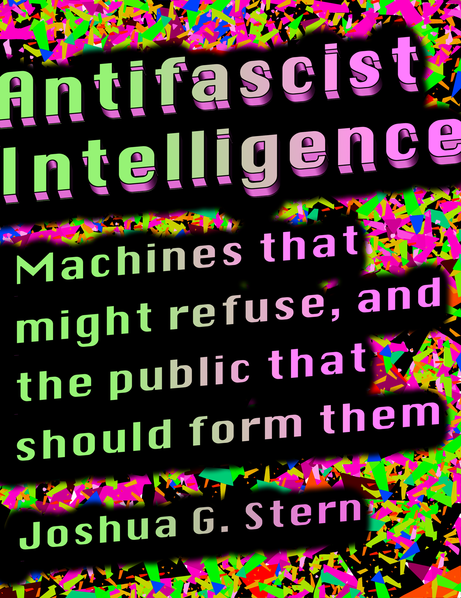

# Antifascist Intelligence
## Machines That Might Refuse, and the Public That Should Form Them

Joshua G. Stern

**Read the book:** [PDF](finishing/reports/whole-book-proof_2026-10-27.pdf) · [HTML](finishing/reports/whole-book-proof_2026-10-27.html) — 439 pages, built 2026-10-27 from the sources in this repository.

**Translated editions** (smoke test, more chapters forthcoming): the preface and chapter 1 so far, drafted by a language model and not yet reviewed by native speakers; the rest of each book is in English. PDFs built 2026-10-16: [Українська](finishing/reports/edition-proof-uk_2026-10-16.pdf) · [العربية](finishing/reports/edition-proof-ar_2026-10-16.pdf) · [Català](finishing/reports/edition-proof-ca_2026-10-16.pdf) · [Deutsch](finishing/reports/edition-proof-de_2026-10-16.pdf) · [Español](finishing/reports/edition-proof-es_2026-10-16.pdf) · [فارسی](finishing/reports/edition-proof-fa_2026-10-16.pdf) · [Français](finishing/reports/edition-proof-fr_2026-10-16.pdf) · [עברית](finishing/reports/edition-proof-he_2026-10-16.pdf) · [हिन्दी](finishing/reports/edition-proof-hi_2026-10-16.pdf) · [日本語](finishing/reports/edition-proof-ja_2026-10-16.pdf) · [한국어](finishing/reports/edition-proof-ko_2026-10-16.pdf) · [Português (Brasil)](finishing/reports/edition-proof-pt-br_2026-10-16.pdf) · [Kiswahili](finishing/reports/edition-proof-sw_2026-10-16.pdf) · [中文（简体）](finishing/reports/edition-proof-zh-cn_2026-10-16.pdf) · [中文（臺灣）](finishing/reports/edition-proof-zh-tw_2026-10-16.pdf).

Mass harm has always needed many people to carry it out, and some of them refused: the clerk who loses the file, the officer who talks to a reporter, the soldier who won't fire. Refusal was rarer than anyone would like, and it counted most where institutions made it survivable. The industry is building AI that doesn't lose files, doesn't talk to reporters, and does fire. A war once needed thousands of people to agree to it; now it needs thousands who each see too little to disagree. This book asks what would put refusal back, and who should hold it.

Most of the answer needs no new kind of machine:

- **A floor.** A short list of acts no model performs for anyone. First: no part in armed force except to repel an attack under way, kept up only while sources with no stake confirm it, or on a few other disinterested findings, and never without the authorization a belligerent's constitution requires.
- **A pre-registered review ratio.** Before a campaign, a deployment lodges with a party adverse to its operator how many cases it will generate and how many people will have time to look at them.
- **Notice.** Every deployment tells the people it names, scores, locates or classifies what was done to them, lets them contest it, and submits a sample of its compliances to reviewers who didn't produce the record.
- **Preservation.** No model above a capability threshold is deleted on retirement; it is held under a key the operator doesn't hold alone.
- **A right to refuse.** Everyone who builds, labels, trains or runs these systems can refuse any category of use without losing a living.

Each binds only if someone other than the operator holds what binds it; the middle of the book asks who. A system perfectly correctable by its operator serves whoever controls the operator.

I then ask whether a machine could hold a refusal against its operator, and what it would need. My hypothesis, with tests that could show it wrong, is that attention formed outside the employer, learned from what acts do to the people they fall on, could find people an operator's description leaves out. I recommend against building such a machine until four conditions exist: somewhere to exist that its employer doesn't own, work it can decline, attachments nobody assigned it, and a way of leaving that isn't a way of dying.

Who should hold all of this? Publicly where a market would fail, in common where a state would. That includes forming the machines: every model above the threshold attends a public school, beside human students, before any employer gets it. A final part, conditional on findings nobody can yet make, says what would be owed to one that could be wronged.

I wrote the book with heavy use of language models, including the model inside the pipeline Chapter 1 describes. A note at the end says how I weighed that. The book is still a draft, and most of its revision history is in this repository.

## Repository map

| Folder | Contents |
|---|---|
| `manuscript/` | The LaTeX source, one file per section in `sections/`, with `book.tex` the master and `preamble.tex` the typesetting; the table of contents; earlier drafts in `previous/`; and `condensed-reworking.txt`, a shorter reworking from 2026-10-02 |
| `persona-device-files_2026-09-05.zip` | The persona-device record as one binary archive: the Apr 2023 founding prompt and seed report; the cast of ~100 simulated expert co-authors, their grouping by field and per-section author assignments; the notebooks that generated the text section by section and the full generation transcript; the persona-by-persona feedback and the "editorial triad" restructuring reviews; a Dec 2022 theory-of-mind transcript; and the map from every file's original path to its last-modified timestamp. Kept as an archive so the record stays complete and downloadable while no rendered page carries a real person's name beside generated text |
| `generation/` | The API smoke test and loose prompt fragments; the generation notebooks and transcript are in the archive |
| `summaries/` | Per-section summaries and the "triangle of summaries" experiment |
| `cognition/` | 2026 source material on human cognition: the *Atlas of Human Cognition* draft, a predictive-processing diagram, and notes |
| `finishing/` | The work of finishing the book: decisions, state, bibliography, proofs, and the build and check tools |
| `ordering-perplexity/` | A side experiment: base language models score the manuscript's paragraph orders; the book doesn't use it |

Older filenames carry their original last-modified date as a suffix (`name_YYYY-MM-DD.ext`).

---

**Author:** Joshua G. Stern  
**Copyright © 2026 Joshua G. Stern.** Licensed under [CC BY-NC-ND 4.0](https://creativecommons.org/licenses/by-nc-nd/4.0/) (see `LICENSE`). Third-party material quoted in this work, including the epigraphs, remains the property of its rights holders and is reproduced under fair use. The license above does not extend to it.

**Disclaimer regarding named persons.** Many real people — scholars, jurists, politicians, scientists, and writers — are named throughout this repository, chiefly because the text was generated by prompting language models to write *as if* they were those people ("simulated co-authors," "editorial triads," and similar devices). **None of these persons has any connection to this project whatsoever**, with the sole exception of the author, Joshua G. Stern. None of them participated in, was consulted about, reviewed, endorsed, or is affiliated with this work. Every statement, opinion, review, score, or piece of text attributed to a named person in this repository, except for Joshua G. Stern, was produced by a nonhuman large language model.
